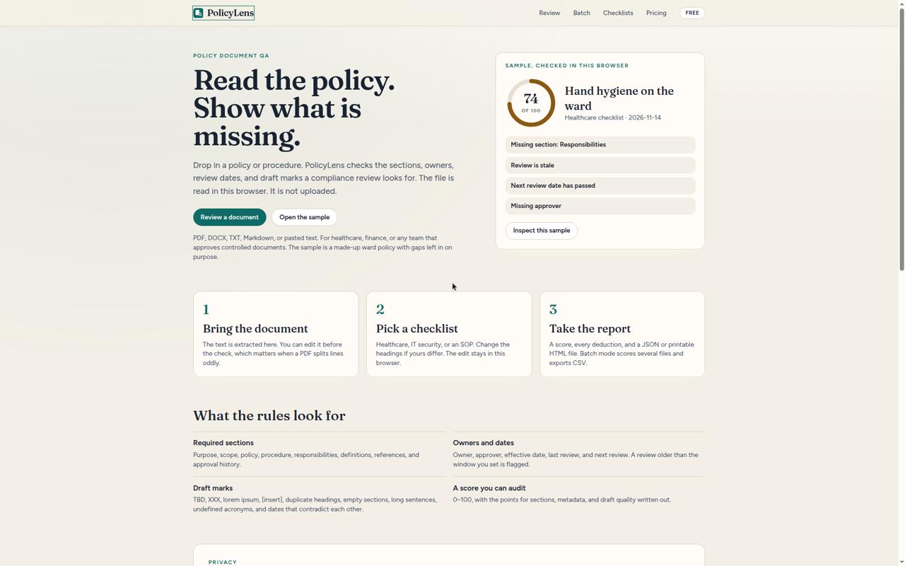
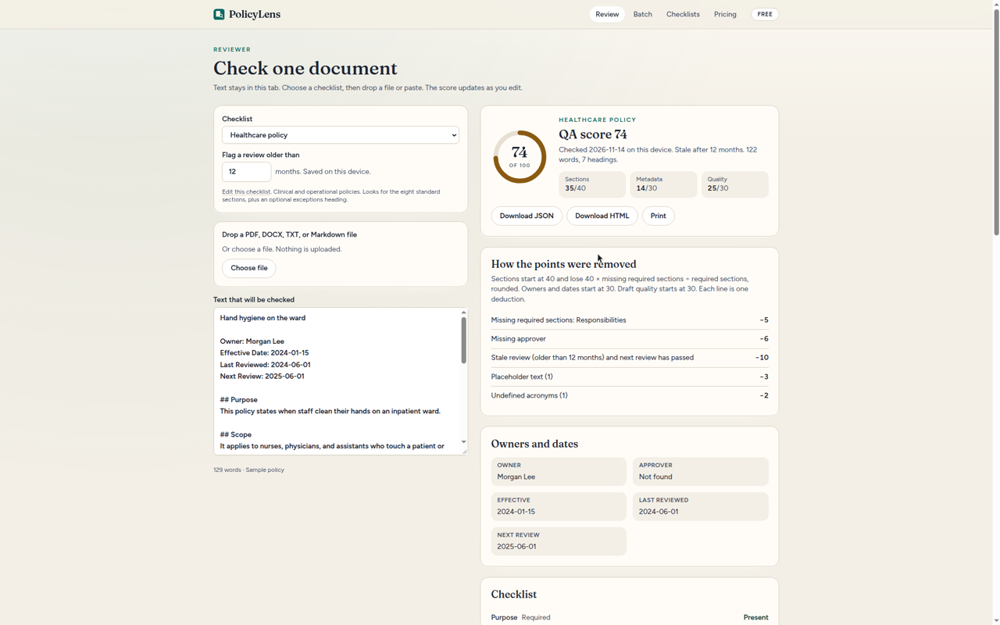
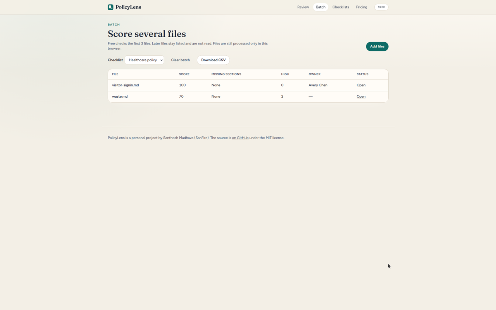
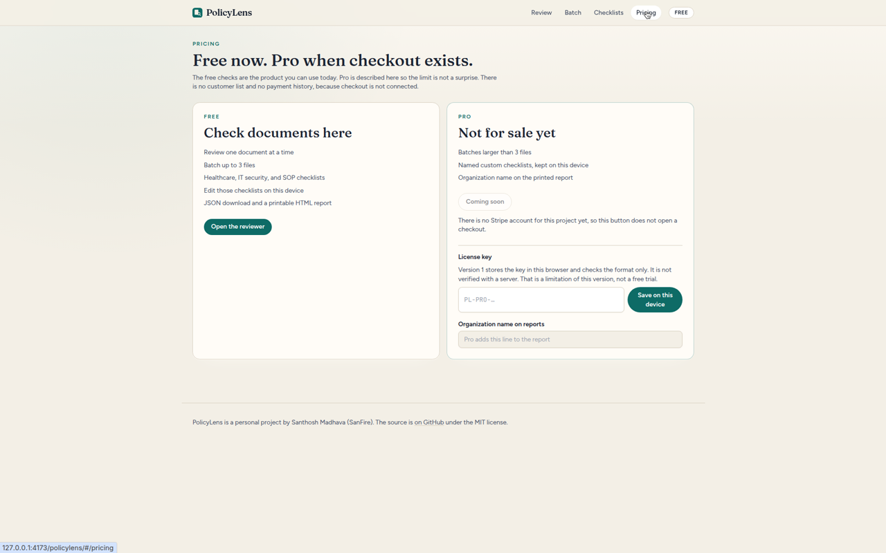

# PolicyLens

Policy document QA for compliance and operations teams. Drop in a policy or procedure and get a score for missing sections, stale review dates, absent owners, and draft problems.

**Live:** [realmpastai-web.github.io/policylens](https://realmpastai-web.github.io/policylens/)

Author: Santhosh Madhava (SanFire)



## What it does

A user adds a PDF, DOCX, TXT, Markdown file, or pasted text. PolicyLens extracts the text in the browser and runs a rules engine:

- Required sections present or missing: Purpose, Scope, Policy, Procedure, Responsibilities, Definitions, References, and Approval / revision history. Healthcare, IT security, and SOP checklists are included. The headings can be edited, and the edit stays in `localStorage`.
- Metadata: owner, approver, effective date, last reviewed date, next review date. A review older than 12 months is flagged. The window is configurable. A next review date that has already passed is flagged too.
- Draft checks: placeholder text (`TBD`, `XXX`, lorem ipsum, `[insert]`), duplicate headings, very long sentences, undefined acronyms, inconsistent dates, and empty sections.
- A QA score from 0 to 100 with the deductions written out.
- JSON download and a printable HTML report.
- Batch mode: several files in a table, with CSV export. Free checks the first 3 files.





An optional model review can call OpenAI or Anthropic with a key you type. It is off until you run it. Its findings sit beside the rule findings and are not part of the score. The response is checked against a JSON schema.

## Privacy

Text is extracted with PDF.js and Mammoth and checked in the page. There is no PolicyLens server and no upload. A scanned PDF with no text layer cannot be read; paste the text instead.

The model review is the only step that sends text off the device, and only to the provider whose key you entered. The key is kept in session storage for that tab.

## Pricing

Free includes single-document review, batches of up to 3 files, the three published checklists (and local edits to them), and the report downloads.

Pro, once checkout exists, is meant to cover larger batches, named custom checklists, and an organization name on the report. The upgrade button reads its URL from `STRIPE_PRO_PAYMENT_LINK` in `apps/web/src/config.ts`. That value is empty, so the button says **Coming soon** and does not open a checkout.



A license key field unlocks Pro in the browser. Version 1 only checks that the key matches `PL-PRO-` plus 16 hexadecimal characters, and it stores the key locally. It is not verified with a server. That is a limitation of this version.

## Architecture

```
apps/web            Vite + React static app, base path /policylens/
packages/core       Rules engine used by the app, the MCP server, and evals
packages/mcp-server stdio MCP server
evals               15 synthetic policies and a precision/recall runner
```

`analyzeDocument(text, options)` is the only check entry point. The score is 40 points for sections, 30 for owners and dates, and 30 for draft quality. Heading matches are exact after normalization, not a loose search. Numeric dates are read as month/day/year. A review on the anniversary of the window is still current; a review strictly older than the window is stale.

## Development

Requires Node.js 22 or newer.

```bash
npm install
npm run dev          # web app
npm test             # unit tests
npm run eval         # precision/recall
npm run lint
npm run typecheck
npm run build        # apps/web/dist and the MCP bundle
```

GitHub Actions runs lint, typecheck, unit tests, evals, and both builds on pull requests. A second workflow deploys `apps/web/dist` to GitHub Pages on push to `main`.

The deploy workflow uses `actions/configure-pages` with `enablement: true`, which creates the Pages site if it does not exist. That call needs `administration: write` on the workflow token. If the run fails with “Resource not accessible by integration”, turn Pages on once in the repository: **Settings → Pages → Build and deployment → Source → GitHub Actions**, then re-run **Deploy GitHub Pages**. After the site exists, later deploys only need `pages: write`.

## MCP server

The server exposes `check_policy_document`, `list_templates`, and `explain_finding`. They call the same rules engine as the site.

```bash
npm install
npm run build -w @policylens/mcp-server
```

Claude Desktop or Claude Code:

```json
{
  "mcpServers": {
    "policylens": {
      "command": "node",
      "args": ["/absolute/path/to/policylens/packages/mcp-server/dist/index.js"]
    }
  }
}
```

`check_policy_document` takes `text`, and optionally `template` (`healthcare`, `it-security`, or `sop`), `referenceDate` (`YYYY-MM-DD`), and `staleReviewMonths`.

## Evals

`evals/src/corpus.ts` holds 15 synthetic policies. They are generic drafts: no real organisation names and no patient or customer data. Each case lists the check ids that must appear and no others. The runner prints precision and recall per check and exits non-zero if a case drifts.

```bash
npm run eval
```

## Roadmap

- A real Stripe Payment Link, then server-side license checks.
- Saved reviews that are not tied to one browser.
- Clearer handling of scanned PDFs.

## License

MIT. See [LICENSE](LICENSE).
